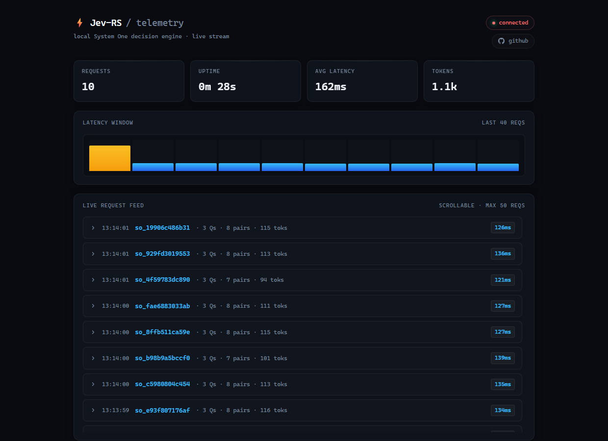

<div align="center">

# ⚡ Jev-RS

### A local, non-autoregressive decision engine.

**One request. One forward pass. Every question answered.**

[](https://github.com/alnyx-dev/jev-rs/releases/latest)
[](https://www.rust-lang.org/)
[](https://onnxruntime.ai/)
[](https://opensource.org/licenses/MIT)
[](https://github.com/alnyx-dev/jev-rs)

</div>

---

A support ticket arrives. You need to know **three** things at once: is it
urgent, which category, and how frustrated the customer is.

An LLM answers with a token stream — slow, stochastic, and it re-reads the
context for every question. A classic classifier answers one label at a time.

**Jev-RS** treats the whole request as **one batch of hypothesis pairs** and
asks the NLI model to entail all of them in a single pass. Every question is
evaluated simultaneously, on the same premise, with calibrated probabilities
and an explicit confidence value.

<div align="center">

|  | Traditional LLM | Classic classifier | **Jev-RS** |
| :--- | :--- | :--- | :--- |
| Questions per request | N sequential calls | 1 label | **N labels, 1 pass** |
| Determinism | sampling-dependent | deterministic | **deterministic** |
| Explainability | free text | label only | **label + distribution + confidence** |
| Output | JSON-ish tokens | class index | **TypeSafe wire protocol** |

</div>

> Measured on the reference setup: **~150 ms** for eight criteria in a single
> request, against **944 ms** for the same eight criteria asked one by one —
> see [Performance](#-performance).

---

## ⚡ Get it running

**Windows — one file, one command:**

```bat
install.bat        :: installs Rust, builds the engine, downloads the model
run.bat            :: starts it and opens the dashboard
```

**Any platform:**

```bash
cargo build --release                              # Windows: DirectML GPU
# cargo build --release --no-default-features       # Linux / macOS: CPU
./target/release/jev-rs --download-model            # fetch the model (~2.3 GB, resumable)
./target/release/jev-rs
```

The server listens on **http://127.0.0.1:8000** — the dashboard is at `/`, the
API at `/v1/systemone`.

> **No Python.** The model is a pre-exported ONNX bundle that the engine
> downloads itself — no virtualenv, no torch, no optimum. The download is
> resumable: if it breaks, run it again.

<details>
<summary><b>Prebuilt binary instead of building?</b></summary>

Grab `jev-rs-windows-x86_64.zip` from the
[latest release](https://github.com/alnyx-dev/jev-rs/releases/latest), extract
it, then:

```bat
jev-rs.exe --download-model
jev-rs.exe
```

</details>

---

## 📡 One request, three answers

```bash
curl -X POST http://127.0.0.1:8000/v1/systemone \
  -H "Content-Type: application/json" \
  -d '{
    "state": "Payment was charged twice, but the order is still pending. Fix this immediately!",
    "questions": {
      "is_urgent": {
        "type": "noul",
        "instructions": "Does this require urgent human intervention?"
      },
      "category": {
        "type": "choice",
        "instructions": "Select issue category",
        "criteria": {
          "billing": "Payment, refund, or invoice issues",
          "tech_bug": "App crash or visual error",
          "general": "General questions"
        }
      },
      "frustration": {
        "type": "score",
        "instructions": "Customer frustration level",
        "criteria": ["Calm", "Annoyed", "Extremely Furious"]
      }
    }
  }'
```

```json
{
  "id": "so_eb0f5c534a9f",
  "model": "local-jev-rust",
  "answers": {
    "is_urgent": {
      "type": "noul",
      "noul": 0.6477
    },
    "category": {
      "type": "choice",
      "choice": "billing",
      "probabilities": { "billing": 0.7356, "tech_bug": 0.1365, "general": 0.1278 },
      "confidence": 0.3076
    },
    "frustration": {
      "type": "score",
      "score": 2.1,
      "probabilities": { "Calm": 0.0645, "Annoyed": 0.7697, "Extremely Furious": 0.1658 },
      "confidence": 0.3845
    }
  },
  "usage": { "input_tokens": 111, "output_tokens": 0 }
}
```

Every answer carries its **full probability distribution** and a **confidence**
value, so downstream code can threshold instead of trusting a single label.
Response headers carry `x-typesafe-request-id` and `x-response-time-ms`.

---

## 🧠 How it works

```
POST /v1/systemone
        │
        │  1. flatten      every question becomes premise/hypothesis pairs
        │                  noul   → "…: Yes, true."  /  "…: No, false."
        │                  choice → one pair per criterion
        │                  score  → one pair per level
        │
        │  2. tokenize     one batched pass over the HuggingFace tokenizer
        │
        │  3. forward      ONE ONNX forward pass over the whole batch
        │                  (DirectML GPU or CPU) → entailment logits
        │
        │  4. calibrate    temperature scaling → probabilities per question
        │                  Shannon entropy → confidence
        │
        └─ 5. answer       { type, value, probabilities, confidence }
```

Every question shares one premise, so the model only has to judge the
**hypothesis** — the decision work is batched, not repeated. That is where the
speed comes from: eight criteria in a single request cost about as much as
one.

<div align="center">

| Workload | One request | Eight requests | Speed-up |
| :--- | :--- | :--- | :--- |
| 8 criteria | **152 ms** | 944 ms | **6.2×** |

</div>

---

## 🎛️ Question types

| Type | Shape | Answer |
| :--- | :--- | :--- |
| `noul` | `instructions` | probability that the state is true |
| `choice` | `instructions` + `criteria` (object or array of strings) | winning option, full distribution, confidence |
| `score` | `instructions` + `criteria` (array of strings, ordered) | expected value `1..N`, full distribution, confidence |

`criteria` is **mandatory** for `choice` and `score`. Malformed criteria are
rejected with `400` instead of being silently coerced, and duplicates are
rejected too — a duplicate would collapse in the probability map while the
winner was still chosen over the full list, which produced distributions that
did not sum to 1.

---

## 🛠️ Routes

| Route | Purpose |
| :--- | :--- |
| `POST /v1/systemone` | inference (requires the API key when `JEV_API_KEY` is set) |
| `GET /` · `GET /dashboard` | live telemetry dashboard |
| `GET /events` | Server-Sent Events — one `req` event per inference |
| `GET /history` | last 50 requests (dashboard backfill) |
| `GET /health` · `GET /ready` | liveness probes |

### Errors

Every error is the same JSON envelope:

```json
{ "error": { "code": 400, "message": "question 'category': duplicate criterion 'billing'" } }
```

| Code | Meaning |
| :--- | :--- |
| `400` | malformed request — unknown type, missing / empty / non-string / duplicate `criteria`, unparsable body, missing field, empty `state`, or a request over the input budget |
| `401` | missing or invalid API key (`JEV_API_KEY` is set) |
| `413` | request body over `JEV_MAX_BODY_BYTES` |
| `503` | no free inference slot (`JEV_MAX_CONCURRENCY`) |
| `504` | inference timed out (`JEV_TIMEOUT`), including the wait for a slot |

A missing field, a missing content type and an unparsable body all answer
`400` — one status, one shape, no surprises for the client.

---

## ⚙️ Configuration

Everything is environment-based; all defaults work out of the box.

| Variable | Default | Description |
| :--- | :--- | :--- |
| `HOST` | `127.0.0.1` | Bind address. A non-loopback host prints a security warning (`JEV_ALLOW_REMOTE=1` acknowledges it). |
| `PORT` | `8000` | Listen port. |
| `JEV_MODEL_PATH` | `model_onnx/model.onnx` | ONNX model file. |
| `JEV_TOKENIZER_PATH` | next to the model | Tokenizer file. When unset, `tokenizer.json` is looked up next to the model, so a model and its tokenizer can never come from different exports by accident. |
| `JEV_TEMPERATURE` | `1.65` | RLCD calibration temperature; must be finite and `0 < t ≤ 10`, otherwise the server refuses to start. |
| `JEV_MAX_BODY_BYTES` | `131072` | Request-body limit (`413`). |
| `JEV_MAX_CONCURRENCY` | `2` | Inference slots (`503` when exhausted). Forward passes themselves are serialized by the session lock. |
| `JEV_TIMEOUT` | `30` | Per-request inference timeout in seconds (`504`). Covers the wait for a slot as well as the forward pass. |
| `JEV_MAX_STATE_CHARS` | `2000` | Maximum number of characters in `state` (`400`). Keeps a premise inside the latency budget. |
| `JEV_MAX_SEQ_TOKENS` | `2048` | Maximum tokens per encoded pair (`400`). Capped by the model's position limit. |
| `JEV_MAX_BATCH_TOKENS` | `8192` | Maximum padded tokens per forward pass, i.e. `pairs × seq_len` (`400`). |
| `JEV_API_KEY` | *(unset)* | When set, the inference endpoint requires `X-API-Key: <key>` or `Authorization: Bearer <key>` (`401`). |
| `JEV_TELEMETRY` | `1` | Set to `0` to retain and broadcast nothing: no request states are stored, the history stays empty and the dashboard shows no feed. Anonymous counters are kept. |

> The input limits are enforced **before** the forward pass, so an oversized
> request is a clean `400` instead of an ONNX Runtime failure. Raise them with
> care — the cost of a pass grows with `pairs × seq_len`.

---

## 📊 Live dashboard

Open **http://127.0.0.1:8000/** — a built-in telemetry page with a live
request feed, a rolling latency chart and rolling counters.



The feed is driven by Server-Sent Events; slow clients receive a `lagged`
notice instead of stalling the engine, and requests delivered by both the
event stream and the `/history` backfill are de-duplicated by request id.

Set `JEV_TELEMETRY=0` to switch the retention off completely: no request state
is stored or broadcast, the history stays empty and the dashboard shows no
feed. Only the anonymous counters remain.

---

## 📈 Performance

Measured on **Windows 11 Pro · AMD Ryzen 7 6800H (16 threads) · AMD Radeon
integrated graphics via DirectML (DirectX 12)** · model
`bge-m3-zeroshot-v2.0` · 20 runs per row, warm:

| Workload | Latency (avg) | Range |
| :--- | :--- | :--- |
| 1 question (`noul`, 2 pairs) | **123 ms** | 117 – 138 ms |
| 3 questions (8 pairs) | **150 ms** | 145 – 172 ms |
| 8 criteria in one request (9 pairs) | **152 ms** | 145 – 178 ms |
| 8 separate requests (1 pair each) | 944 ms total | — |

Latency grows with `pairs × seq_len`, not with the number of requests — that
is the whole point of the design. Inference runs off the async worker threads,
so `/health` and the dashboard stay responsive while a batch is evaluated.

> The CPU build (`--no-default-features`) is several times slower; it exists
> for machines without a DirectX 12 GPU. Measure on your own hardware.

---

## 🚧 Honest limitations

- **`choice` and `score` normalize independent hypotheses.** The probabilities
  come from a softmax over separate NLI evaluations, so two criteria that are
  both true compete for the same probability mass. They are comparable
  rankings, not independent probabilities.
- **Forward passes are serialized.** One ONNX session, one mutex: concurrent
  requests queue instead of running in parallel. `JEV_MAX_CONCURRENCY` is a
  queue depth, not a parallelism knob.
- **`JEV_TEMPERATURE` is a fixed default.** `1.65` is an RLCD-style
  correction for this model, not something the engine re-fits per request.
- **No authentication by default.** The engine binds to loopback and prints a
  warning on a non-loopback host. Set `JEV_API_KEY` before exposing it.
- **The bundle is ~2.3 GB.** The weights are fp32, so the first run needs the
  download and roughly 3 GB of disk.

---

## 🛠️ Development

```bash
cargo test --release          # 46 unit tests
cargo build --release         # Windows / DirectML
cargo build --release --no-default-features   # CPU-only build
cargo fmt --all              # formatting (enforced in CI)
cargo clippy --all-targets --all-features
```

CI runs on every push: formatting, clippy with `-D warnings`, and the unit
tests against both the DirectML and the CPU-only build.

<details>
<summary><b>Project layout</b></summary>

```
jev-rs/
├── src/
│   ├── main.rs          # HTTP server, batched inference, calibration
│   ├── download.rs      # ONNX bundle download from the Hugging Face Hub
│   ├── dashboard.rs     # SSE + history endpoints
│   └── dashboard.html   # self-contained telemetry page
├── scripts/
│   ├── setup_model.py   # optional: ONNX export for models without one
│   ├── test_request.ps1 # smoke test (PowerShell)
│   └── test_request.sh  # smoke test (bash)
├── docs/dashboard.png   # screenshot for the README
├── .cargo/config.toml   # MSVC linker flags, macOS availability symbols
├── .github/workflows/   # ci.yml (fmt, clippy, tests) + release.yml
├── rust-toolchain.toml  # pinned toolchain channel
├── install.bat          # Windows one-time setup
├── run.bat              # Windows launcher
└── Cargo.toml
```

</details>

---

## 📦 Releases

Portable Windows builds are published on every tag:

```bash
git tag v0.x.y && git push
```

The archive contains `jev-rs.exe`, the license and this README — the model is
downloaded on first run.

---

## 📜 License

MIT — free for commercial and private use. See [LICENSE](LICENSE).
